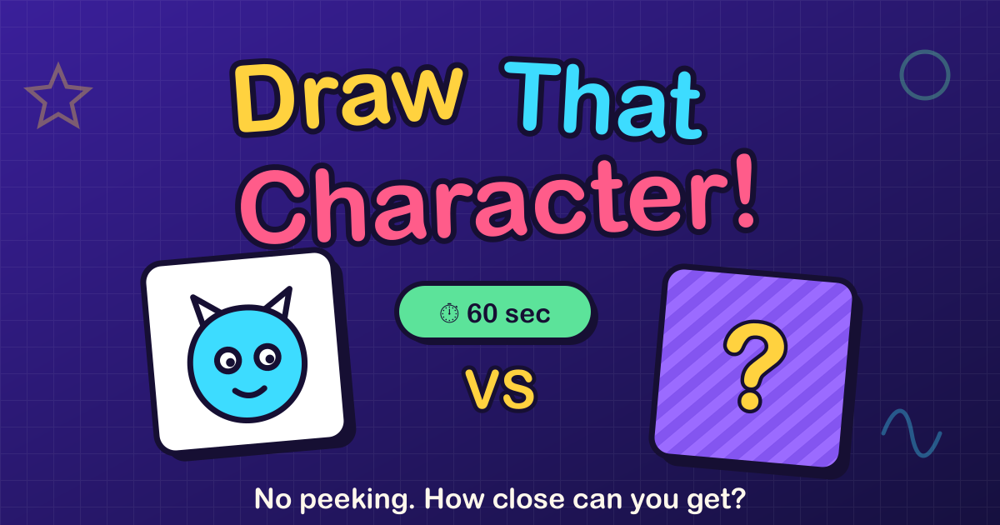

# Draw That Character!



You get a cartoon character's **name** and **60 seconds** to draw it from memory — no peeking. When time's up (or you hit "done"), your drawing flips up side-by-side with the real character and you get a **match %**.

- 260+ characters across Classic Cartoons, Disney & Pixar, TV Cartoons, Anime and Video Games
- Brush, fill bucket, eraser, 4 brush sizes, 16 colors, undo
- Daily Challenge (same character for everyone each day)
- Score breakdown (shape, lines, colors), personal stats and a gallery of past drawings
- Shareable side-by-side image

Plain HTML/CSS/JS, no build step. Scoring runs entirely in the browser (`scoring.js`): both images are cropped to the subject, normalised, then compared on silhouette overlap, line placement (chamfer distance) and colour palette/layout.

Reference images are loaded from Wikipedia at play time. Fan-made; characters belong to their respective owners.

## Run locally

```bash
python3 -m http.server 5178
```
